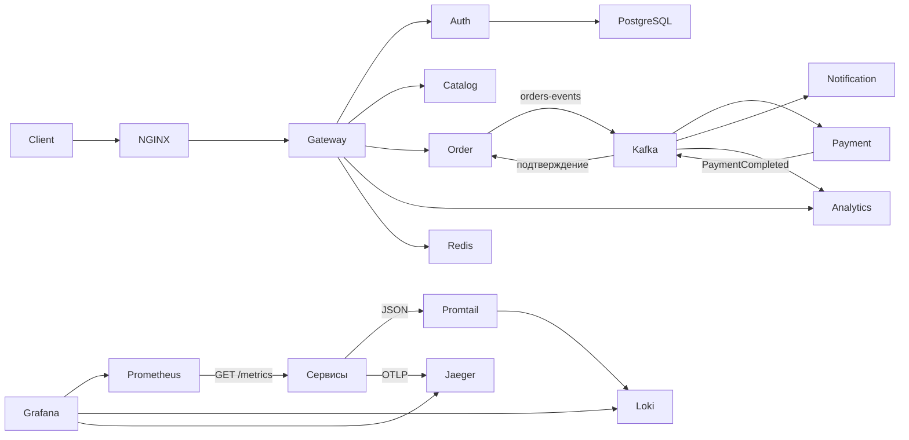

# Архитектура Marketplace

|Сервис|Ответственность|Порт|Технологии|
|---|---|---|---|
|NGINX / Gateway|Вход, JWT, права и лимит по IP|18080 / 8000|NGINX, FastAPI, Redis|
|Auth|Учётные записи, роли, JWT|8001|FastAPI, bcrypt, PostgreSQL|
|Catalog × 2|Каталог товаров|8002|FastAPI, SQLite|
|Order|Команды, журнал событий и проекция|8003|FastAPI, SQLite, Kafka|
|Payment|Обработка заказа и публикация оплаты|8004|FastAPI, Kafka|
|Notification|Уведомления об оплате|8006|FastAPI, Kafka|
|Analytics|Агрегация заказов и оплат|8007|FastAPI, SQLite, Kafka|
|GraphQL|Альтернативный интерфейс|8005|Strawberry|
|Kafka / RabbitMQ|События / очереди прежней саги|9092 / 5672|Kafka, AMQP|
|PostgreSQL / Redis|Пользователи / счётчики лимита|5432 / 6379|PostgreSQL, Redis|
|Consul|Реестр сервисов|8500|Consul|
|Prometheus / Grafana|Сбор метрик / дашборды|9090 / 3000|PromQL, Grafana|
|Loki / Promtail|Индексирование / сбор журналов|3100 / 9080|LogQL, Docker SD|
|Jaeger|Приём OTLP, просмотр трейсов|4318 / 16686|OpenTelemetry, Jaeger|

Внешний HTTP-порт NGINX — 18080. Порты приложений доступны внутри сети Compose. Gateway направляет запросы каталога на catalog-1. Kafka переносит контекст заказа в поле context.traceparent. Payment публикует подтверждение в payment-completed. Order записывает OrderPaid, а Analytics обновляет свою проекцию.

