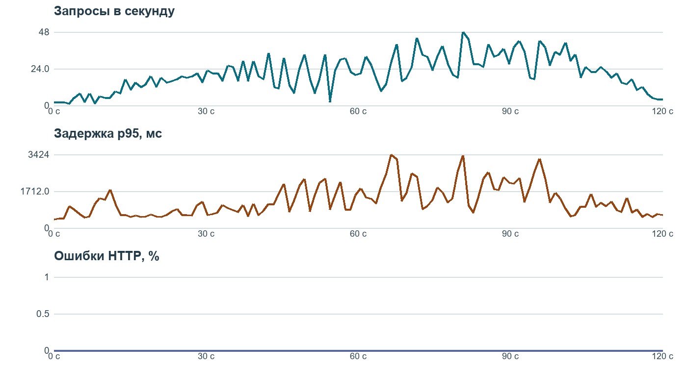
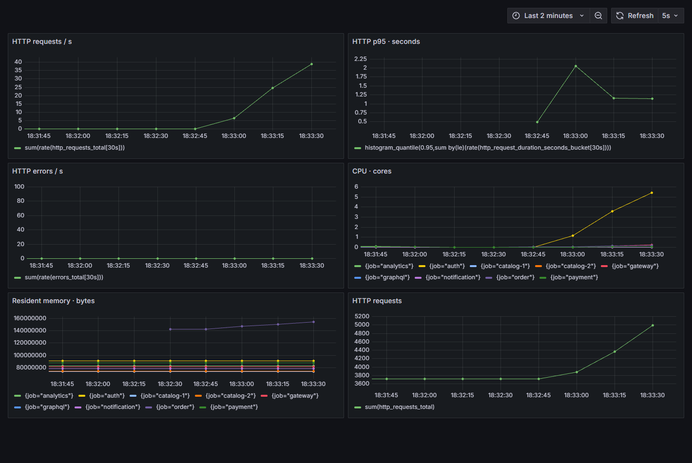

# Marketplace · лабораторные работы 7–9

Из корня локальной рабочей копии labs-7-9 выполните команды ниже. Для получения исходного репозитория используется `git clone https://github.com/Lyn0o/marketplace.git`. Изменения лабораторных находятся в локальной ветке labs-7-9.

```powershell
Copy-Item .env.example .env
# В .env задайте JWT_SECRET (32+ символа), ADMIN_PASSWORD (12+) и POSTGRES_PASSWORD.
# Для воспроизведения нагрузки задайте RATE_LIMIT=20000 и RATE_WINDOW=60.
docker-compose up -d --build
python scripts/check_labs.py
docker run --rm --network labs79_default --mount "type=bind,source=$($PWD.Path)/load,target=/load,readonly" grafana/k6:0.55.0 run /load/order.js
```

API через http://127.0.0.1:18080. Регистрация и вход — POST /auth/register и /auth/login. С JWT пользователя — GET /catalog/products, POST /orders, GET /orders/{id}. С JWT администратора — GET /analytics/summary. OpenAPI сервиса — /auth/openapi.json.

[Архитектура и порты](ARCHITECTURE.md) · [Технический дашборд](http://127.0.0.1:13000/d/technical) · [Бизнес-дашборд](http://127.0.0.1:13000/d/business) · [Jaeger](http://127.0.0.1:16686) · [Prometheus](http://127.0.0.1:19090).

## Нагрузочный тест

k6, 30 с до 20 VU, 60 с до 50 VU, 30 с до 0 VU. За итерацию — вход, создание заказа и пауза 1 с. 2491 HTTP-запрос, 1245 заказов, 20,60 запроса/с в среднем, 10,30 заказа/с. Ошибок 0. Пик за секундное окно — 48 запросов/с. p50 / p95 / p99 — 575 / 1989 / 2869 мс (округлённо). p95 входа — 2324 мс, заказа — 1163 мс. Наибольшая задержка наблюдалась при входе, где выполняется проверка bcrypt.




## Предыдущие лабораторные

# Marketplace — лабораторная работа 6

CQRS и Event Sourcing для заказов, Kafka и отдельный Analytics Service.

## Запуск

1. Скопировать `.env.example` в `.env`, задать случайный JWT_SECRET (от 32 символов)
   и ADMIN_PASSWORD (от 12 символов). Файл `.env` не отправляется в Git.
2. Запустить `docker compose up -d --build`.
3. Открыть http://localhost/orders/docs и http://localhost/analytics/docs.
   В Swagger нажать Authorize, войти как admin с паролем из `.env`.
4. Kafka UI: http://localhost:8080, кластер marketplace, топик orders-events.
5. Проверки: `docker compose exec order python -m pytest tests -q`.

Для отдельного стенда рядом со старой лабораторной можно задать в `.env`
`COMPOSE_PROJECT_NAME=marketplace-lab6`. Порты 80, 8080, 8500 и 15672 должны быть свободны.

## Команды и запросы

- `POST /orders/`: `{"userId":"admin","items":[{"productId":"1","quantity":1}],"totalAmount":1500}`
- `POST /orders/{id}/pay`: `{"paymentMethod":"card"}`
- `POST /orders/{id}/cancel`: `{"reason":"Передумал"}`
- `GET /orders/{id}`: чтение только orders_view.
- `GET /orders/{id}/events`: диагностический просмотр истории Event Store.
- `POST /orders/admin/rebuild`: пересборка read-модели из событий (admin).
- `GET /analytics/summary`: статистика (admin).

Через gateway доступны также адреса без завершающего слеша: `/orders`.
Команды проверяют владельца, восстанавливают агрегат, проверяют бизнес-правила
и сохраняют событие вместе с outbox. Версия защищает от конкурентной записи.
Фоновый publisher отправляет события в Kafka с ключом orderId.
Consumer orders-read-model-group асинхронно обновляет orders_view.
Consumer analytics-service-group независимо строит статистику.

В лабораторной 6 оплата выполняется явной командой /pay, а не автоматически
через Saga из лабораторной 5. Старые Payment/Notification сервисы сохранены,
но поток команд ЛР6 не запускает их платёжную цепочку.
Отмена оплаченного заказа разрешена по сценарию защиты. Возврат денег не моделируется:
paid_amount — сумма событий оплаты, включая позже отменённые заказы;
average_order_amount — среднее по всем созданным заказам.

## Надёжность и восстановление

Event Store, read-модель и аналитика сохраняются в SQLite на Docker volume.
Для чтения используется отдельная таблица, не источник истины.
Kafka offset фиксируется после записи проекции. Повторная доставка безопасна:
read-модель проверяет version, аналитика — eventId и version.
Некорректный JSON пропускается с записью в лог; ошибки БД повторяются без commit.
При недоступности Kafka outbox сохраняет события до повторной отправки.

После обычного перезапуска аналитика продолжает с сохранённого offset и SQLite.
Если удалить только БД аналитики, необходимо также сбросить offset её consumer group
на earliest при остановленном сервисе и заново проиграть топик.
Сброс offset без удаления БД безопасен благодаря дедупликации.
Не удаляйте Docker volumes с данными без необходимости.

Отчёт и текст для защиты находятся в reports/lab6.
